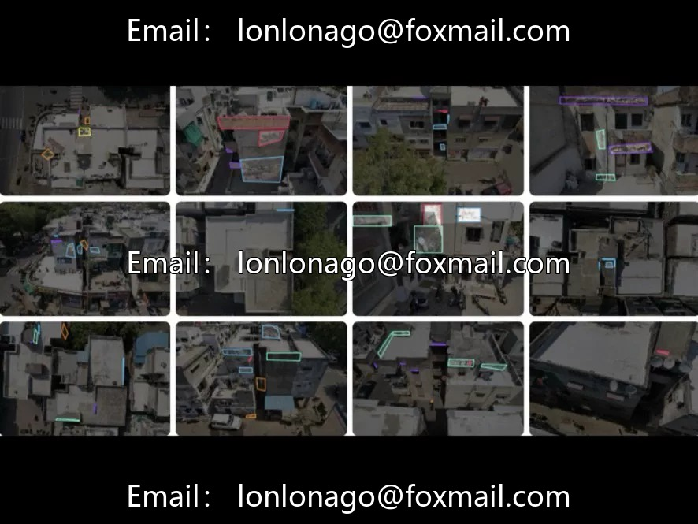
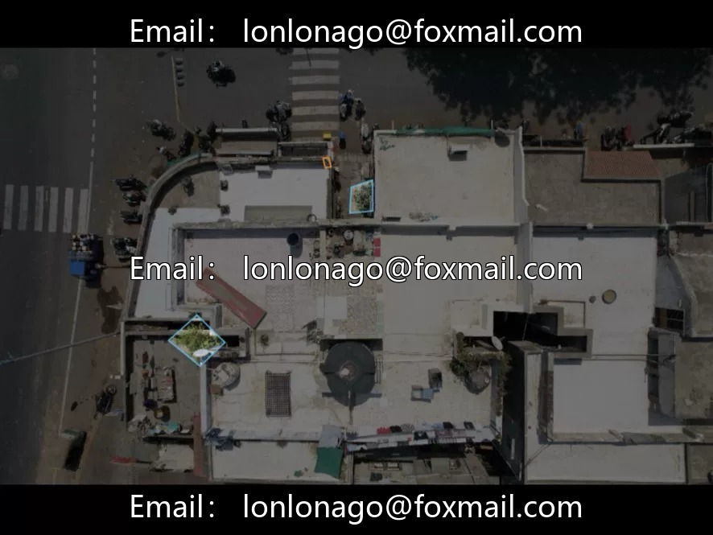
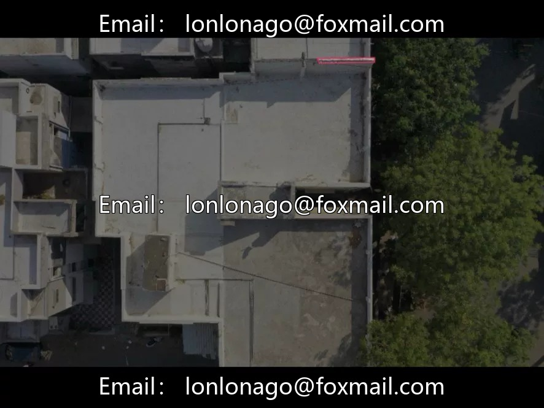
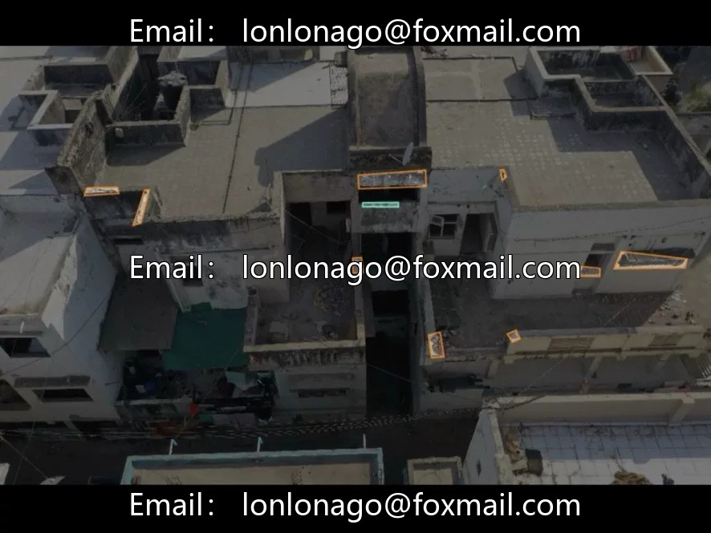
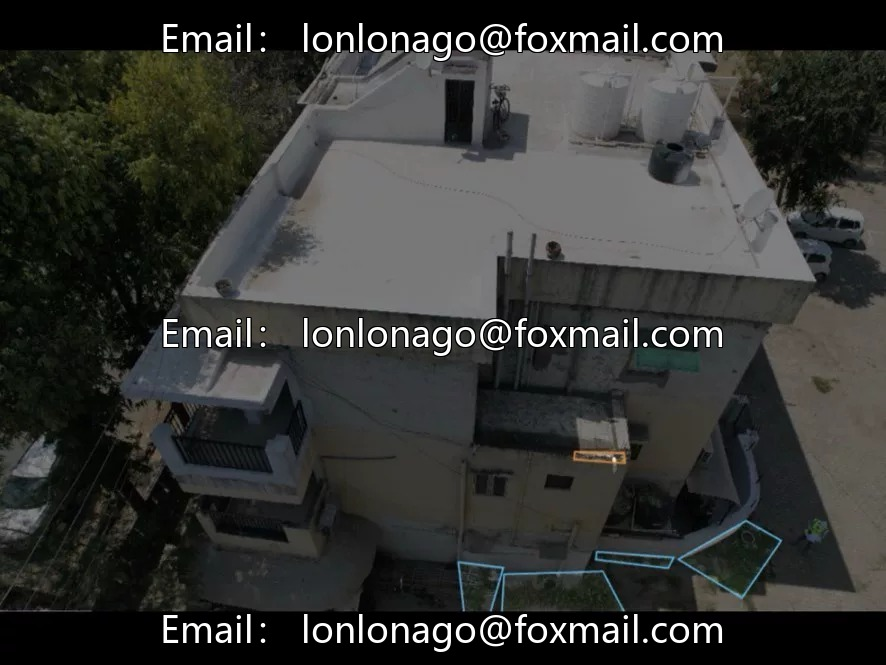
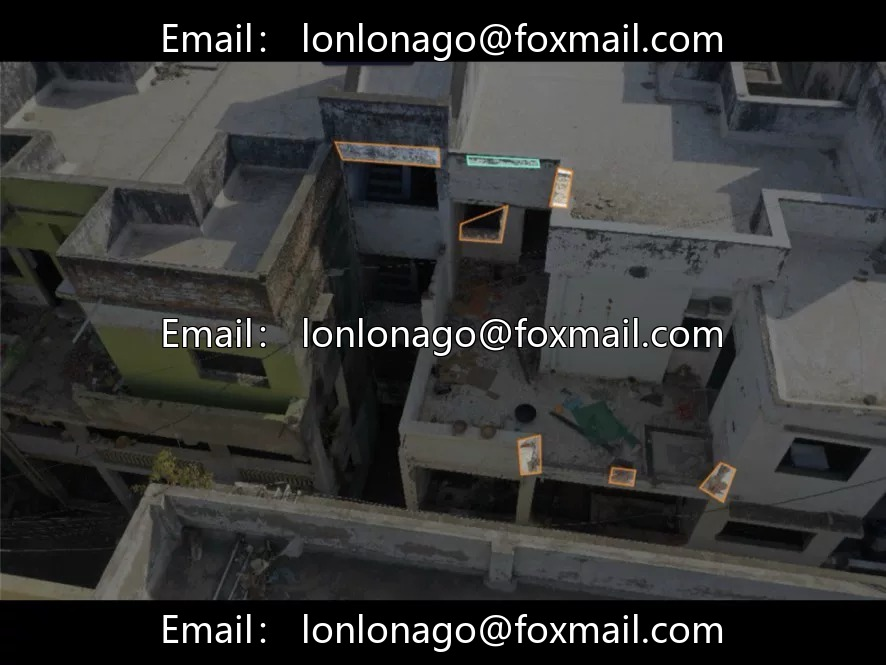

# UAV Building Facade Defects Dataset | 1307 images, 8 categories, YOLO format

## Body

UAV Building Facade Defects Dataset | 1307 images, 8 categories, YOLO format - Issue 10795

The dataset contains 1307 architectural facade images in YOLO format, with 8 categories of targets: vegetation, cleanliness, dampness, suspicion, repetition, plaster damage, structural damage, and wall cracks. Suitable for tasks such as building safety inspections, housing quality assessments, and urban old residential area renovation monitoring.

Category design covers the exterior and structural condition of buildings: structural damage (cracked plaster, structural damage, wall cracks) directly reflect the safety status of the building. Environmental factors (vegetation, humidity) assess the surrounding environment and waterproof status of the building. Cleanliness, skepticism, repetition are evaluational annotations that may be used for quality grading or anomaly marking. Class 8 design considers both physical defects and operational status dimensions.

Application Scenarios: Building exterior safety inspection and defect identification, housing quality testing and risky building warning, urban renewal and old residential area renovation monitoring, compliance check of surrounding environment of buildings.

Technical Solution: YOLOv1.1 training code, 200 epochs, 640 resolution. Suitable for building detection, structural damage recognition, urban renewal projects.

Virtual materials, once sold, are non-refundable.
Interested friends, click "I want" to proceed.

## Images

## Payment

Here is a pay link on Stripe ( https://buy.stripe.com/3cs8yP7sY87d0vu9AB ). Please contact me lonlonago@foxmail.com after funding $89, and I will send you a complete data files , thank you!

